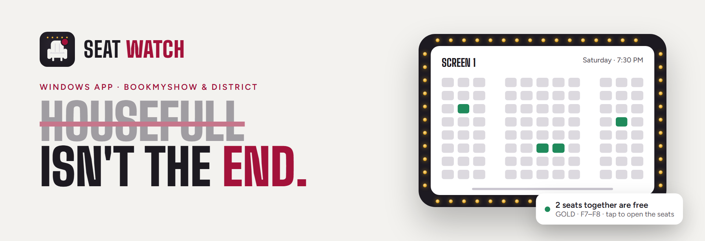
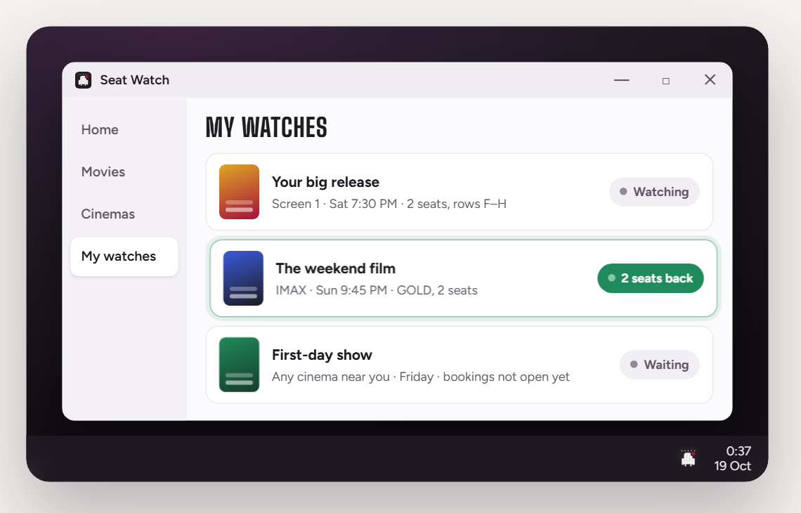

<a href="https://bmstickethelper.dpdns.org">
  <picture>
    <source media="(prefers-color-scheme: dark)" srcset="assets/banner-dark.png">
    
  </picture>
</a>

  After a show sells out, <b>seats can come back</b>: blocks the cinema held back, bookings nobody paid for,
  last-minute cancellations. Seat Watch runs on your Windows PC, keeps an eye on the shows you pick and
  <b>alerts you the moment seats are free again</b>. You book them yourself.

  

  
  
  
  

  <a href="https://bmstickethelper.dpdns.org">Website</a> ·
  <a href="https://github.com/sishirD/seatwatch-releases/releases/latest">What's new</a> ·
  <a href="#questions">Questions</a> ·
  <a href="https://bmstickethelper.dpdns.org/privacy">Privacy</a>

---

## What it does

<table>
<tr>
<td width="33%" valign="top"><h3>🎬 Watch what you want</h3>A show, a cinema and date, or a film before bookings even open.</td>
<td width="33%" valign="top"><h3>💺 Only your seats</h3>Pick rows or categories on the real seat map, and how many seats you need together (1 to 10).</td>
<td width="33%" valign="top"><h3>🔔 Alerts where you are</h3>A Windows notification with a link straight to the seats, and on your phone too through the free <a href="https://ntfy.sh">ntfy</a> app.</td>
</tr>
<tr>
<td valign="top"><h3>🌙 Quiet hours</h3>Alerts arrive silently when you choose; checking carries on.</td>
<td valign="top"><h3>🏙️ Both sites, two cities</h3>BookMyShow and District, in Hyderabad and Bengaluru.</td>
<td valign="top"><h3>🔒 Stays on your PC</h3>Your watches and settings live on your PC. No ads, no tracking.</td>
</tr>
</table>

> **Alerts only.** Seat Watch never books, holds or pays for anything, and never asks for your BookMyShow or District
> login. When seats come back, you book them on the booking site as usual.

## Get started

| 1. Download | 2. Install | 3. Watch |
| --- | --- | --- |
| Get [`SeatWatchSetup.exe`](https://github.com/sishirD/seatwatch-releases/releases/latest/download/SeatWatchSetup.exe) (about 70 MB). | Run it. If Windows says *"Windows protected your PC"*, choose **More info**, then **Run anyway**. | Pick BookMyShow or District and your area, then add a watch. It lives in your tray. |

Seat Watch updates itself: when a new version is ready, the app tells you and installs it in one click.

## Questions

<b>Is it free?</b>

Yes. No ads, no subscription. Without an account you get 1 watch; a free account gives you 5 and shares them
between your PCs.

<b>Does it book tickets for me?</b>

No. It tells you when the seats you want are free; you book them yourself on BookMyShow or District.

<b>Will I always get tickets?</b>

No one can promise that: seats come back at random and go fast. Seat Watch makes sure you hear about them in time.

<b>Does my PC need to be on?</b>

Yes, Seat Watch checks while your PC is on and the app is running (it keeps the PC awake meanwhile).

<b>Why does Windows warn me?</b>

The app isn't code-signed yet, so Microsoft SmartScreen doesn't know it. Choose **More info**, then **Run anyway**.
Only download Seat Watch from this page or [its website](https://bmstickethelper.dpdns.org).

<b>Where are the older versions?</b>

Only the newest version is offered and supported, so everyone gets the latest fixes. If you have an older installer,
please use the download above instead.

<b>How are updates kept safe?</b>

The update information in [`status.json`](status.json) is signed. The app only installs a version that is newer than
the one you have, comes from this page's releases, and matches the signed size and SHA-256.

---

  Seat Watch is an independent tool. It isn't made by, endorsed by or connected with BookMyShow, District or Zomato.
   <code>status.json</code> is read by the app to tell you when a new version is ready.

